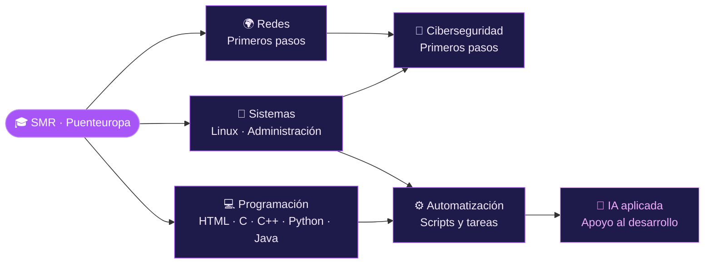

<a href="https://github.com/Scantrex">
  
</a>


---

### `$ whoami`

```text
Scantrex
────────────────────────────────────────────────────────
Estudios    : Grado Medio en Sistemas Microinformáticos y Redes (SMR)
Centro      : Puenteuropa
Aprendiendo : HTML · C · C++ · Python · Java
Explorando  : Linux · Redes · Ciberseguridad · Automatización · IA aplicada
Objetivo    : Entender cómo funciona todo por dentro
Lema        : "Paso a paso, pero sin parar."
```

Estoy construyendo una base sólida en programación y en sistemas: desde una línea de código hasta la infraestructura que la sostiene.
Uso la IA como apoyo para aprender más rápido, resolver dudas y experimentar, **sin dejar de entender lo que hago**.

---

### `$ ./estado.sh`

| 📚 En formación | 🔭 En exploración |
| :-- | :-- |
| 🎓 Sistemas Microinformáticos y Redes | 🐧 Linux y administración de sistemas |
| 🌐 HTML | 🌍 Redes: primeros pasos |
| ➕ C y C++ | 🔐 Ciberseguridad: primeros pasos |
| 🐍 Python | ⚙️ Automatización de tareas |
| ☕ Java | 🤖 IA aplicada al desarrollo |

---

### `$ ls ~/stack`

**Sistemas operativos**


**Programación y scripting**


**Herramientas**


---

### `$ tree ~/roadmap`



---

### `$ cat objetivos.md`

- [ ] **Consolidar bases:** programación en varios lenguajes
- [ ] **Crear proyectos:** cada vez más completos
- [ ] **Sistemas y redes:** seguir aprendiendo cada día
- [ ] **Crecer como técnico:** mejorar un poco cada día

---

### `$ gh stats Scantrex`

<p>
  
  
</p>


<!-- 🐍 SERPIENTE DE CONTRIBUCIONES (opcional)
1. Crea un repositorio llamado igual que tu usuario: Scantrex/Scantrex
2. Sube el archivo .github/workflows/snake.yml
3. Ve a Actions > "Generate Snake" > Run workflow
4. Cuando termine, quita las marcas de comentario de este bloque:

<picture>
  <source media="(prefers-color-scheme: dark)" srcset="https://raw.githubusercontent.com/Scantrex/Scantrex/output/github-snake-dark.svg">
  <source media="(prefers-color-scheme: light)" srcset="https://raw.githubusercontent.com/Scantrex/Scantrex/output/github-snake.svg">
  
</picture>
-->

---

### `$ ls ~/proyectos`

```text
drwxr-xr-x  practicas-de-clase/     # ejercicios y prácticas del ciclo
drwxr-xr-x  pruebas-lenguajes/      # pruebas con HTML, C, C++, Python y Java
drwxr-xr-x  proyectos-personales/   # irán apareciendo según avance
```

Aquí iré subiendo los ejercicios, scripts y pequeños proyectos que voy haciendo mientras aprendo. Te invito a explorarlos a medida que crezcan.

---

### `$ contact --open`

<a href="https://github.com/Scantrex"></a>

<!-- ✉️ Si quieres añadir tu correo, quita las marcas de comentario y cambia el email:
<a href="mailto:TU_CORREO@ejemplo.com"></a>
-->

---

> *"Todo lo que sé hoy, hace un tiempo no lo sabía. La constancia es lo que marca la diferencia."*


<sub>`$ exit 0` · Perfil en constante construcción · Hecho con curiosidad y mucho café ☕</sub>
